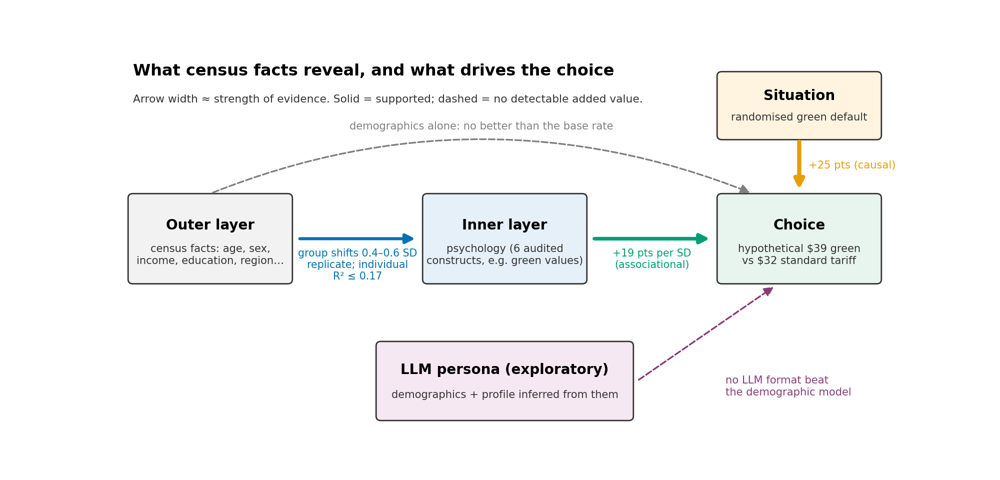
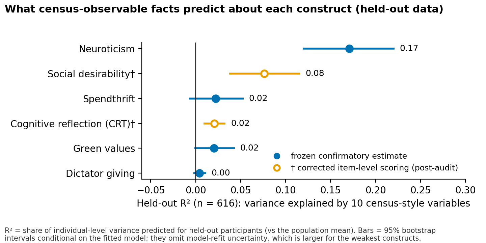
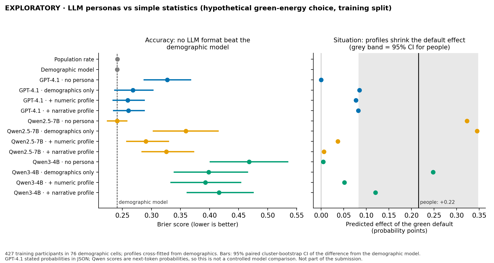
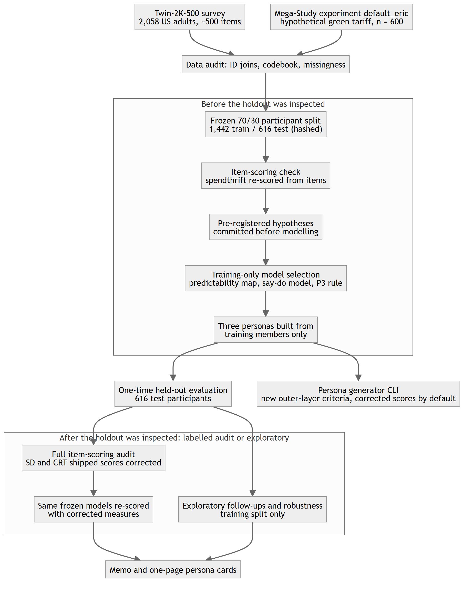

# What can census facts tell you about how people think?

**Research question.** Given only census-observable facts about a group (age, sex, income, education, region…), how much can we infer about its psychology and its choices, and how confident should we be?

**Abstract.** This is an applied-research study of 2,058 US adults from the public Twin-2K-500 panel, linked to a randomised experiment in the same people. It uses a frozen train/held-out split, pre-registered hypotheses and a one-time held-out evaluation, and everything regenerates from one command.

Three findings:
- **Demographics capture real group-level differences.** For temperament and self-presentation, census-defined groups differ from the population by about 0.4–0.6 SD, and these shifts replicated on held-out people.
- **They predict individuals weakly.**
- **They add nothing detectable for a hypothetical green-energy choice.** A randomised default and one measured attitude both mattered for that choice.

In separate, exploratory benchmarks run after the submission, giving LLM personas a demographic-inferred psychological profile did **not** improve prediction of that choice over a simple statistical demographic baseline. This is evidence from one limited benchmark, not a general result about LLM personas. *Brace research assignment.*



*Overview.*
- *Census facts (the outer layer) reveal group-level temperament but little about individuals.*
- *The hypothetical green choice tracks the randomised default (causal) and measured green values (associational).*
- *Neither demographics alone nor exploratory LLM personas built from them beat a simple statistical baseline.*
- *Every number is from the [memo](reports/memo.md) or the [GPT-4.1 results](research_frontier/brace_challenge_lab/F3_gpt41/RESULTS.md).*

**Contents:**
- [Key findings](#key-findings)
- [Personas](#the-three-personas)
- [Green-energy choice](#the-green-energy-choice-attitude-default-and-demographics)
- [Exploratory LLM benchmarks](#exploratory-llm-persona-benchmarks-not-part-of-the-submission)
- [What this study suggests](#what-this-study-suggests)
- [Design and data](#research-design-and-data)
- [Reproduce](#reproduce)
- [New personas](#build-a-persona-for-a-new-group)
- [Limitations](#limitations)
- [Documents](#documents)

## Key findings

The study keeps three questions apart:
- **Psychological plausibility:** does a persona read like a coherent person?
- **Predictability of psychology from demographics:** do census facts predict a person's measured traits?
- **Predictive validity for behaviour:** do they predict what people choose?

A persona can do well on the first and still fail the other two.

1. **On the six audited constructs, census facts mostly see age-linked temperament and self-presentation.**
   - Ten census-style variables explain 17% of held-out individual variance in neuroticism and 8% in social desirability.
   - They explain about 2% or less in green values, money style (spendthrift), cognitive reflection (CRT-2) and dictator giving.
   - Age alone gives about half of the neuroticism signal and about 60% of the social-desirability signal.
   - These six were pre-registered; they are not a sample of all psychology. An exploratory sweep of 50 shipped scores (training only, not independently re-scored) found a median R² of 0.05 and a maximum of 0.16.
2. **Low individual R² does not mean negligible group differences.**
   - Every persona trait classed as distinct on training data kept its direction on held-out people.
   - Where a trait was distinct, the persona mean cut individual prediction error by 9–14% in four of six cases; it was about 0 elsewhere.
   - A random person aged 65+ is still more neurotic than a random 18–29-year-old a quarter of the time.
3. **For a hypothetical green-energy choice, the situation and one measured attitude matter, and demographics do not.**
   - A randomised green default raised the renewable choice by **+25 points** (16–33). This is causal.
   - +1 SD of green values goes with **+19 points** (15–22). This is associational.
   - No demographic-only model improved on the base rate by more than 0.003 in Brier score.
4. **LLM personas did not beat a simple statistical baseline in our benchmark** (exploratory; see [below](#exploratory-llm-persona-benchmarks-not-part-of-the-submission)).

> **Measurement note.** Three of the dataset's six published scale scores are mis-scored by string-matching bugs (409, 180 and 450 people). We reproduced each bug exactly and report corrected values. One bug had created a false "older people are less reflective" pattern. Details are in the [statistical audit](reports/final_audit/statistical_audit.md).



*Figure 1. Held-out predictive performance of the frozen ridge model (Tier A census variables, fitted on the training split only).*
- *R² is the share of individual-level variance among the 616 held-out participants that the model predicts, relative to the population mean.*
- *Because the predictions are averages for demographic cells, R² = 0.17 for neuroticism means those averages differ meaningfully while 83% of person-to-person variation remains unexplained.*
- *Bars: 95% bootstrap intervals over held-out participants, conditional on the fitted model. They do not include model-refitting uncertainty, which a training-only check found similar for neuroticism but about 2–3× larger for green values and CRT. CRT's held-out R² of 0.02 is therefore not a robust positive signal: with refitting, its training-only interval includes zero ([audit](research_frontier/01_project_red_team.md)).*
- *† Corrected item-level scoring applied after the audit. Source: [`figures/data/fig1_heldout_r2.csv`](figures/data/fig1_heldout_r2.csv).*


*Group differences vs individual prediction.*
- *Neuroticism of 18–29-year-olds vs adults 65+ (training split).*
- *The means differ by 0.87 SD, a large group difference, yet the distributions overlap so much that a random 65+ member is more neurotic than a random 18–29-year-old 25% of the time.*
- *Source: [`figures/data/fig5_group_vs_individual.csv`](figures/data/fig5_group_vs_individual.csv).*

## The three personas

Membership is defined only by census-observable facts. Each card fits on one page and states what is robust, what is fragile and where the persona breaks.

| Persona | Who | n | What holds up (d vs population: training → held-out) | Fragile or not supported |
|---|---|---|---|---|
| [P1](reports/personas/P1_adults_65plus.md) | Age 65+ | 277 | Lower neuroticism (−0.43 → −0.58); higher social desirability† (+0.39 → +0.47) | Green choice same as population; "less reflective" withdrawn (scoring artefact) |
| [P2](reports/personas/P2_under50_income_below_50k.md) | Age 18–49, household income < $50k | 425 | Higher neuroticism (+0.47 → +0.55); income matters within each age band under 65 | "More spendthrift" falsified; "budget-constrained green chooser" failed the holdout; lower social desirability is weak after shrinkage |
| [P3](reports/personas/P3_young_never_married.md) | Age 18–29, never married | 285 | Higher neuroticism (+0.43 → +0.55) | Lower green values (−0.27 → −0.40) are fragile: weak after shrinkage, no supported sex difference, significant in only 3 of 6 redefinitions |

**The personas are not independent.**
- P1 is defined by age alone.
- P2 and P3 share a high-neuroticism profile, and 41% of P3's training members are also in P2.
- The held-out evaluation largely confirms one age gradient; three personas are closer to two.


*Figure 2. Standardised differences from the training population, with 95% CIs, for training members (circles) and held-out members (squares). † Corrected scores. Source: [`figures/data/fig2_persona_d.csv`](figures/data/fig2_persona_d.csv).*

## The green-energy choice: attitude, default and demographics

**The study** (Mega-Study `default_eric`, n = 600; 428 training): a **hypothetical** choice between a $39 renewable tariff and a $32 standard tariff, with a randomised green or grey default. No one paid anything.

**Results:**
- Green values predict the choice, and the default changes it.
- A "say–do gap" appears only in the loose sense. About half of people at or above the 67th-percentile green-values score still decline renewable when it means switching: 47% on train and 50% on test. But the green-values items never mention paying more and the choice is hypothetical, so this is not a measured attitude–behaviour contradiction.


*Figure 3. **Exploratory, training split only (n = 428).***
- *Shows the out-of-fold Brier change against the prevalence baseline, for a **hypothetical** survey choice of a $39 renewable tariff over a $32 one; this is not a purchase.*
- *Lower Brier is better. Bars: 95% paired participant-bootstrap intervals.*
- *The randomised default has a large causal effect on the choice rate (+25 points). It also adds predictive value: in a later post-hoc, training-only comparison (same participants and folds), "green values + default" improved Brier by −0.014 (95% CI −0.025 to −0.003) over "green values only", both without demographics ([X1](research_frontier/04_experiment_designs.md)).*
- *Source: [`figures/data/fig3_green_choice_brier.csv`](figures/data/fig3_green_choice_brier.csv).*

## Exploratory LLM persona benchmarks (not part of the submission)

These were run after the submission, in [`research_frontier/`](research_frontier/), on training participants only. **No submitted estimate depends on them.**

**Question.** Does an LLM persona predict the green-energy choice better than statistics? Three prompt formats were compared:
- demographics only;
- demographics plus a **demographic-inferred** psychological profile, as numbers;
- the same numbers written as a **narrative** persona.

**Design:**
- Profiles were estimated from census cells on the other half of the training data.
- Prompts contained only k-anonymous demographic cells (k ≥ 5), aggregate profile estimates and scenario text.
- Both answer orders were averaged.
- Scoring was a pre-registered, cross-fitted Brier score at the group level, applied to each participant (427 people in 76 cells).
- Uncertainty is a paired cluster bootstrap over cells.

**GPT-4.1** via OpenRouter: 1,556 responses, all valid, about $1.25 billed ([results](research_frontier/brace_challenge_lab/F3_gpt41/RESULTS.md), [decision memo](research_frontier/brace_challenge_lab/F3_gpt41/DECISION_MEMO.md)).

| Method | Brier score | Δ vs demographic model [95% CI] |
|---|---:|---|
| Population baseline (condition rate) | 0.2414 | — |
| Demographic model (logistic, 4 cell fields + condition) | 0.2410 | — |
| GPT-4.1, demographics only | 0.268 | +0.027 [−0.004, +0.062] |
| GPT-4.1, numeric psychological profile | 0.259 | +0.018 [−0.007, +0.047] |
| GPT-4.1, narrative psychological profile | 0.260 | +0.019 [−0.006, +0.046] |

Lower Brier is better.

- **None of the GPT-4.1 formats passed the pre-registered "adds value" criterion,** which required beating the demographic model with a CI excluding 0.
- **Profile vs demographics:** −0.009 [−0.024, +0.006].
- **Narrative vs numeric:** +0.001.
- **The default effect:** GPT-4.1 predicted about +0.08, against +0.215 in people on the same participants.
- **No-persona prompt:** GPT-4.1 ignored the default entirely, answering 0.75 in both conditions (Brier 0.327).



*Exploratory LLM benchmark (not part of the submission).*
- *Left: Brier score for each method, with 95% paired cluster-bootstrap intervals for the difference from the demographic model.*
- *Right: the predicted effect of the green default, against people's +0.22 (grey band: 95% CI).*
- *Qwen2.5's no-persona tie with the baselines averages two strongly order-dependent answers, so it is not evidence of skill.*
- *Source: [`figures/data/fig6_llm_benchmark.csv`](figures/data/fig6_llm_benchmark.csv).*

**Qwen2.5-7B and Qwen3-4B** (open-weight, run on Modal GPUs; [results](research_frontier/brace_challenge_lab/F2_modal_open_weight/RESULTS.md)):
- Every persona format scored worse than the demographic model (Brier 0.29–0.42).
- Narrative wording made predictions more confident without making them more accurate.
- Qwen2.5 was highly sensitive to option order (mean absolute gap 0.51).

**These are not a controlled model comparison.**
- GPT-4.1 *stated* a probability in JSON; the Qwen models were scored from *next-token* probabilities, with a different final instruction.
- All LLM prompts used an abridged paraphrase of the survey scenario and omitted its original "Stay with / Switch to" wording.
- The **published** GPT-4.1 digital-twin predictions (Peng et al.) are a third, separate source, compared in [`research_frontier/09_existing_llm_benchmark.md`](research_frontier/09_existing_llm_benchmark.md). Those twins received much richer information than our census-only models:
  - the full-persona twins saw about 500 of each participant's own survey answers;
  - the demographics-only prompts' exact fields are not public.

## What This Study Suggests

These are cautious readings of a limited benchmark: one hypothetical choice, one panel, training data only for the LLM work.
- **Coherent is not the same as accurate.**
  - Adding inferred traits can make a persona read as a more coherent person.
  - Here, it did not make an LLM's predictions of what people chose more accurate.
  - With a profile, GPT-4.1's predictions tracked the profile's green-values number closely (r ≈ 0.77) while under-weighting the randomised default.
- **Inferred traits contain no new information.**
  - A psychological profile estimated *only* from demographics cannot add information beyond those demographics. It is a function of them.
  - At most, presenting it explicitly could help a model *use* information it already had. We found no detectable benefit of that kind for GPT-4.1, and a small benefit for one Qwen model that still left it worse than the statistical baseline.
- **Group description is where demographics help.**
  - Census-defined personas can describe group-level temperament and self-presentation, with shifts that replicated.
  - For choices, the evidence here points to two things instead: measuring one relevant attitude directly, and testing the situation (the default) experimentally.
- **What would change this reading.** Any of these could produce a different answer:
  - other scenarios or real (incentivised) choices;
  - richer outer-layer data;
  - other models or elicitation methods.

## Research design and data

<p align="center"></p>

*Figure 4. Analysis pipeline. Mermaid source: [`figures/pipeline.mmd`](figures/pipeline.mmd) (render with `python tools/render_mermaid.py`).*

### Evaluation protocol
- **Split:** the participant split (`data/split.csv`; 1,442 train / 616 test) was frozen and hashed before analysis. A test checks the hash.
- **Pre-registration:** the hypotheses ([`hypotheses.md`](hypotheses.md)) were committed before modelling.
- **Holdout:** the holdout script was committed before its single run. The frozen outputs in [`results/`](results/) have been byte-stable since.
- **Training-only work:** personas are built from training members only (tested). Everything run after the holdout was inspected is labelled audit or exploratory, and uses training data when it involves modelling.
- **Later corrections:** each one is logged in [`post_review_corrections.md`](reports/final_audit/post_review_corrections.md). No estimate, split or held-out result changed.

### Data provenance and attribution
- [Twin-2K-500](https://huggingface.co/datasets/LLM-Digital-Twin/Twin-2K-500): Toubia et al., 2025, [arXiv:2505.17479](https://arxiv.org/abs/2505.17479).
- [Twin-2K-500 Mega-Study](https://huggingface.co/datasets/LLM-Digital-Twin/Twin-2K-500-Mega-Study): Peng et al., [arXiv:2509.19088](https://arxiv.org/abs/2509.19088).
- The assignment brief describes both datasets as CC BY 4.0; the Mega-Study's Hugging Face card lists Apache-2.0. Raw data are downloaded by the pipeline and are not committed.
- The outer layer is restricted to 10 census/ACS-observable variables. Party, ideology and religion are excluded (`audit/variable_map_outer.csv`).

## Reproduce

```bash
python -m venv .venv
source .venv/bin/activate        # Windows Git Bash: source .venv/Scripts/activate ; PowerShell: .venv\Scripts\Activate.ps1
pip install -r requirements.txt
python run_all.py                # download → audit → analyses → holdout → personas → audit → 43 tests
python tools/make_figures.py     # Figures 1–3 (byte-reproducible); tools/render_mermaid.py renders Figure 4
```

This needs Python 3.11 and internet access for the first run (about 60 MB from Hugging Face; the download resumes if interrupted). It was tested on a fresh clone in a fresh virtual environment: all tests pass, and every output matches the committed values ([details](reports/final_audit/live_review_simulation.md); latest fresh-clone check in [`SUBMISSION_READINESS.md`](SUBMISSION_READINESS.md)).

The exploratory LLM benchmarks are **not** part of `run_all.py`, and they need API or GPU access. Their analyses rerun offline from the committed outputs; see each folder.

## Build a persona for a new group

```bash
python src/personas.py build --name midwest_women_50plus --criteria "region=Midwest (ND, SD, NE, KS, MN, IA, MO, WI, IL, MI, IN, OH); sex=Female; age_band=50-64|65+"
```

**Tested output:**
- n = 95 (69 train / 26 held out).
- Neuroticism d = −0.26 (CI −0.49 to −0.04), distinct.
- Social desirability d = +0.24 (CI +0.01 to +0.48): distinct on the raw mean, but **not distinguishable after shrinkage**, and both labels are shown.
- The green choice is flagged **insufficient evidence** (11–13 people per condition).
- The report is written to `reports/generated/`.

**How the generator behaves:**
- Only census-observable variables are accepted (`python src/personas.py list-levels`).
- A variable repeated with contradictory levels is rejected.
- Groups with fewer than 30 training members return INSUFFICIENT EVIDENCE.
- Behaviour needs at least 20 people per default condition.
- Corrected scores are the default. `--legacy-scores` reproduces the defective published scores for historical comparison only.

## Limitations
- **Constructs.** The six audited constructs do not represent all psychological traits. The breadth sweep's additional scores are exploratory and were not independently re-scored.
- **Group vs individual.** Low individual-level R² does not mean group differences are negligible, and group differences do not license individual predictions.
- **Hypothetical choices.** Every "decision" is a hypothetical survey choice. No study offered real incentives.
- **Small cells.** Some behavioural cells are small (P3: 16–17 per condition). Persona-level behaviour rates did not forecast held-out behaviour.
- **Overlapping personas.** The three personas overlap and are driven mainly by age. None covers ages 50–64.
- **Sample.** The panel is online and not representative. Mega-Study participants skew older (22% are 65+ vs 10%).
- **Coarse categories.** Age is recorded in 4 bands and income in 5, which caps what census variables can reveal.
- **LLM benchmarks** (exploratory):
  - one scenario, a paraphrased prompt that omits the survey's "Stay with / Switch to" wording, and small cells;
  - GPT-4.1 and Qwen probabilities come from different elicitation methods;
  - the GPT-4.1 snapshot behind the API alias cannot be verified;
  - the published GPT-4.1 twins used much richer participant information than our census-only models.
- **Labelling.** Analyses run after the holdout was inspected are labelled exploratory or audit, and are training-only where they involve modelling.
- **The generator** reports numbers and evidence labels. It does not write explanations; that remains the analyst's job.

## Documents

**Submission deliverables** (see [`SUBMISSION.md`](SUBMISSION.md)):

| Document | What it is |
|---|---|
| [Research memo](reports/memo.md) | 4 pages, conclusions first |
| [Persona cards](reports/personas/) | One page each; full tables in `*_evidence.md` |
| [Exploration log](reports/exploration_log.md) | What was tried, dropped and why |
| [AI use and verification](reports/ai_note.md) | Tools used, how their work was checked, and what was AI-suggested vs verified |

**Supporting evidence:**

| Document | What it is |
|---|---|
| [Statistical audit](reports/final_audit/statistical_audit.md) | Scale re-derivation, scoring defects, corrected reruns |
| [Post-review corrections](reports/final_audit/post_review_corrections.md) | Every change made after the holdout; no estimate changed |
| [Headline challenge](reports/final_audit/headline_challenge.md) | Attempts to falsify the main claim |
| [Pre-registration](hypotheses.md) | Hypotheses committed before modelling |
| [Submission readiness](SUBMISSION_READINESS.md) | Final checks, commands and the fresh-clone result |
| [Original README](docs/README_original.md) | The previous README, archived verbatim |

**Exploratory research** (optional; not part of the submitted findings):

| Folder | What it is |
|---|---|
| [`research_frontier/`](research_frontier/README.md) | Red team, literature, theory audit and next steps |
| [`research_frontier/brace_challenge_lab/`](research_frontier/brace_challenge_lab/MORNING_BRIEF.md) | Persona mechanisms, unseen-group stress test, say–do reassessment, review simulation, client briefs, LLM benchmarks (F, F2, F3) |
| [`research_frontier/breadth_sweep/`](research_frontier/breadth_sweep/README.md) | All 50 usable shipped scores, and the organ-donation choice (exploratory, unaudited) |
| [`review_packet/`](review_packet/00_README.md) | Compact packet for an independent review |
