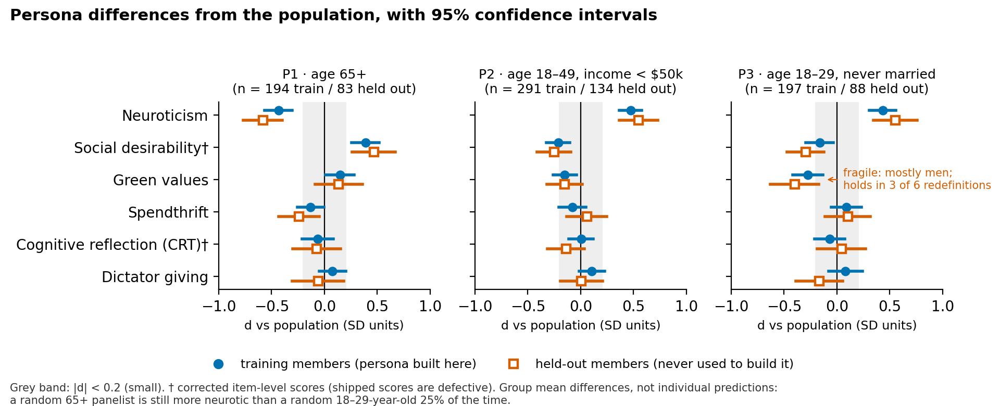
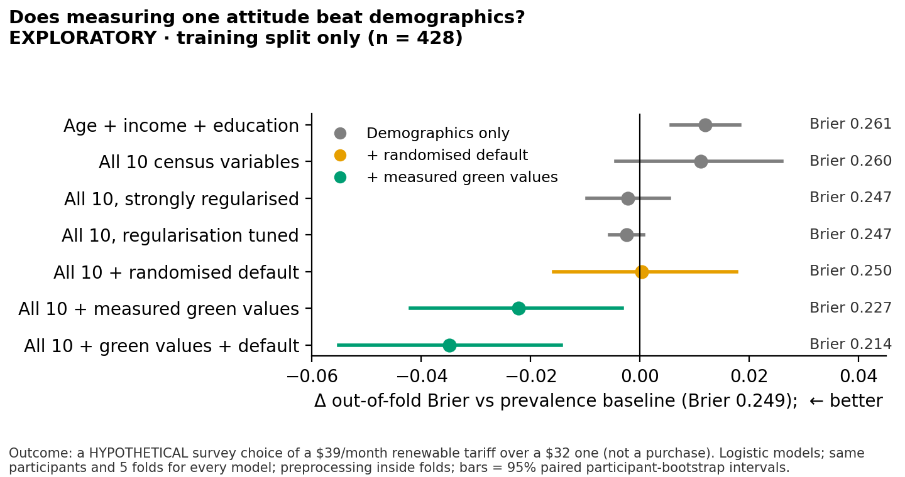
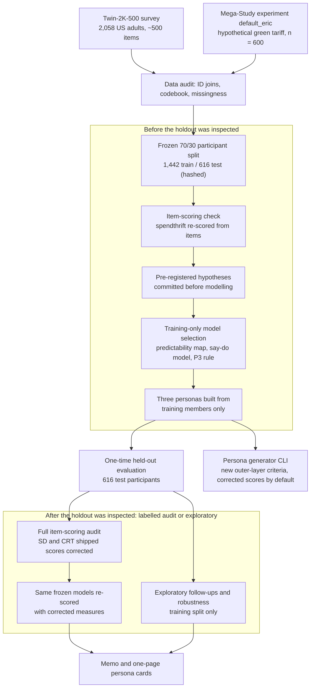

# What can census facts tell you about how people think?

**Research question.** Given only census-observable facts about a group (age, sex, income, education, region…), how much can we infer about its psychology and its choices, and how confident should we be?

This is an applied-research study of 2,058 US adults from the public Twin-2K-500 panel, linked to a randomised experiment in the same people. It uses a frozen train/held-out split, pre-registered hypotheses and a one-time held-out evaluation. Everything regenerates from one command. *Brace research assignment.*

## Key findings

1. **Census facts mostly see age-linked temperament, not values, cognition or choices.**
   - Ten census-style variables explain 17% of held-out variance in neuroticism and 8% in social desirability.
   - They explain about 2% or less in green values, money style (spendthrift), cognitive reflection and generosity.
   - Age alone accounts for about half of the neuroticism signal.
2. **For a hypothetical green-energy choice, one measured attitude beats every demographic model.**
   - Adding a 6-item green-values scale to demographics and the randomised default cut out-of-fold prediction error (Brier) by 0.035, with a 95% CI excluding zero.
   - No demographic-only model, however simple or regularised, improved on the base rate by more than 0.003.
   - *Exploratory, training data only.*
3. **Personas replicate as group shifts, not as individual predictions.**
   - Every persona trait classed as distinct on training data kept its direction on held-out people. For four of the six, the persona cut individual prediction error by 9–14%; for the other two, by about 1–2%.
   - A random person aged 65+ is still more neurotic than a random 18–29-year-old a quarter of the time.

> **Measurement note.** Three of the dataset's six published scale scores are mis-scored by string-matching bugs (409, 180 and 450 people). We reproduced each bug exactly and report corrected values. One bug had created a false "older people are less reflective" pattern. Details are in the [statistical audit](reports/final_audit/statistical_audit.md).


*Figure 1. Held-out R² for the frozen ridge model (Tier A census variables, fitted on the training split; n = 616 held out). Bars: 95% bootstrap intervals over held-out participants. † Corrected item-level scoring applied after the audit. Source: [`figures/data/fig1_heldout_r2.csv`](figures/data/fig1_heldout_r2.csv).*

## The three personas

Membership is defined only by census-observable facts. Each card fits on one page and states what is robust, what is fragile and where the persona breaks.

| Persona | Who | n | What holds up (d vs population: training → held-out) | Fragile or not supported |
|---|---|---|---|---|
| [P1](reports/personas/P1_adults_65plus.md) | Age 65+ | 277 | Lower neuroticism (−0.43 → −0.58); higher social desirability† (+0.39 → +0.47) | Green choice same as population; "less reflective" withdrawn (scoring artefact) |
| [P2](reports/personas/P2_under50_income_below_50k.md) | Age 18–49, household income < $50k | 425 | Higher neuroticism (+0.47 → +0.55), within every age band | "More spendthrift" falsified; "budget-constrained green chooser" failed the holdout |
| [P3](reports/personas/P3_young_never_married.md) | Age 18–29, never married | 285 | Higher neuroticism (+0.43 → +0.55) | Lower green values (−0.27 → −0.40) are concentrated in men and hold in only 3 of 6 redefinitions |



*Figure 2. Standardised differences from the training population, with 95% CIs, for training members (circles) and held-out members (squares). † Corrected scores. Source: [`figures/data/fig3_persona_d.csv`](figures/data/fig3_persona_d.csv).*

## Does measuring an attitude help? (exploratory)



*Figure 3. **Exploratory, training split only (n = 428).** Out-of-fold Brier change against the prevalence baseline for a **hypothetical** survey choice of a $39 renewable tariff over a $32 one; this is not a purchase. Bars: 95% paired participant-bootstrap intervals. The randomised default has a large causal effect on the choice rate (+25 points), but adds little prediction once green values are known. Source: [`figures/data/fig2_green_choice_brier.csv`](figures/data/fig2_green_choice_brier.csv).*

## Research design


*Figure 4. Analysis pipeline. A static copy is at [`figures/fig4_pipeline.png`](figures/fig4_pipeline.png).*

**Data provenance**
- [Twin-2K-500](https://huggingface.co/datasets/LLM-Digital-Twin/Twin-2K-500): Toubia et al., 2025, [arXiv:2505.17479](https://arxiv.org/abs/2505.17479).
- [Twin-2K-500 Mega-Study](https://huggingface.co/datasets/LLM-Digital-Twin/Twin-2K-500-Mega-Study): Peng et al., [arXiv:2509.19088](https://arxiv.org/abs/2509.19088).
- The assignment brief describes both datasets as CC BY 4.0; the Mega-Study's Hugging Face card lists Apache-2.0. Raw data are downloaded by the pipeline and are not committed.
- The outer layer is restricted to 10 census/ACS-observable variables. Party, ideology and religion are excluded (`audit/variable_map_outer.csv`).

## Reproduce

```bash
python -m venv .venv
source .venv/bin/activate        # Windows Git Bash: source .venv/Scripts/activate ; PowerShell: .venv\Scripts\Activate.ps1
pip install -r requirements.txt
python run_all.py                # download → audit → analyses → holdout → personas → audit → 35 tests
python tools/make_figures.py     # Figures 1–3 (byte-reproducible); tools/render_mermaid.py renders Figure 4
```

This needs Python 3.11 and internet access for the first run (about 60 MB from Hugging Face; the download resumes if interrupted). It was tested on a fresh clone in a fresh virtual environment: all tests pass, and every output matches the committed values ([details](reports/final_audit/live_review_simulation.md)).

## Build a persona for a new group

```bash
python src/personas.py build --name midwest_women_50plus --criteria "region=Midwest (ND, SD, NE, KS, MN, IA, MO, WI, IL, MI, IN, OH); sex=Female; age_band=50-64|65+"
```

Tested output: n = 95 (69 train / 26 held out); social desirability d = +0.24 (CI +0.01 to +0.48); neuroticism d = −0.26 (CI −0.49 to −0.04); the green choice is flagged **insufficient evidence** (11–13 people per condition). The report is written to `reports/generated/`.

- Only census-observable variables are accepted (`python src/personas.py list-levels`).
- Groups with fewer than 30 training members return INSUFFICIENT EVIDENCE.
- Corrected scores are the default. `--legacy-scores` reproduces the defective published scores for historical comparison only.

## Limitations
- Every "decision" is a **hypothetical** survey choice. No study offered real incentives.
- The panel is online, not representative, and Mega-Study participants skew older.
- Age is recorded in 4 bands and income in 5, which caps what census variables can reveal.
- Analyses run after the holdout was inspected are labelled exploratory or audit, and are training-only where they involve modelling.
- The persona generator reports numbers and evidence labels. It does not write explanations; that remains the analyst's job.

## Documents
| Document | What it is |
|---|---|
| [Research memo](reports/memo.md) | 4 pages, conclusions first |
| [Persona cards](reports/personas/) | One page each; full tables in `*_evidence.md` |
| [Exploration log](reports/exploration_log.md) | What was tried, dropped and why |
| [AI use and verification](reports/ai_note.md) | Tools used and how their work was checked |
| [Statistical audit](reports/final_audit/statistical_audit.md) | Scale re-derivation, scoring defects, corrected reruns |
| [Headline challenge](reports/final_audit/headline_challenge.md) | Attempts to falsify the main claim |
| [Pre-registration](hypotheses.md) | Hypotheses committed before modelling |
| [Submission manifest](SUBMISSION.md) | Deliverables, supporting evidence and historical artefacts |
| [Original README](docs/README_original.md) | The previous README, archived verbatim |
