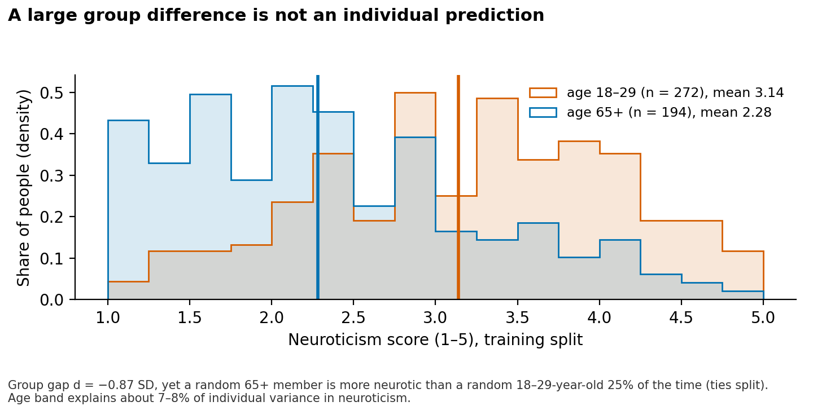

# What can census facts tell us about how people think and choose?

This project asks a simple question for the Brace research assignment: **given only facts a census could record about a group (age, sex, income, education, region and similar), how much can we infer about its psychology and its choices, and how sure can we be?**

It uses 2,058 US adults from the public Twin-2K-500 panel, linked to a randomised experiment taken by 600 of them. The design is strict:
- the train/held-out split was frozen and hashed before analysis;
- hypotheses were pre-registered before modelling;
- the held-out set was evaluated once.

Everything regenerates from one command.

**The short answer:**
- census facts describe some *group-level* temperament differences reliably;
- they predict *individuals* weakly;
- they add nothing detectable for the one costed choice we could test, a hypothetical green-energy tariff.

## Submission deliverables

| # | Deliverable | File |
|---|---|---|
| 1 | Research memo (4 pages) | [`reports/memo.md`](reports/memo.md) |
| 2 | Persona 1: adults 65+ | [`reports/personas/P1_adults_65plus.md`](reports/personas/P1_adults_65plus.md) |
| 3 | Persona 2: ages 18–49, household income under $50k | [`reports/personas/P2_under50_income_below_50k.md`](reports/personas/P2_under50_income_below_50k.md) |
| 4 | Persona 3: ages 18–29, never married | [`reports/personas/P3_young_never_married.md`](reports/personas/P3_young_never_married.md) |
| 5 | Exploration log | [`reports/exploration_log.md`](reports/exploration_log.md) |
| 6 | AI use and verification | [`reports/ai_note.md`](reports/ai_note.md) |
| 7 | Reproducibility instructions | [Reproduce the analysis](#reproduce-the-analysis) |
| 8 | New-persona generator | [Build a persona for a new group](#build-a-persona-for-a-new-group) · [`src/personas.py`](src/personas.py) |

[`SUBMISSION.md`](SUBMISSION.md) lists every file and says which are current findings, which are historical, and which are exploratory.

## Key findings

Each finding carries its evidence status:
- **Confirmatory:** pre-registered, frozen held-out set.
- **Corrected:** rerun with fixed item-level scoring after the holdout.
- **Exploratory:** training data only, after the holdout, not pre-registered.

**1. Census facts mainly see age-linked temperament** (confirmatory; † corrected).
- Ten census-type variables explain **17%** of held-out individual variance in neuroticism and **8%**† in social desirability.
- They explain **2% or less** in green values, money style, CRT-2 reflection and dictator giving.
- Age carries about half of the neuroticism signal.
- We had pre-registered the opposite (H1: reflection visible, temperament not), so H1 was falsified.
- These six constructs are not all of psychology. An exploratory sweep of 50 scores reached at most 0.16.

**2. Group differences are real, but they are not individual predictions** (confirmatory).
- Over-65s and 18–29-year-olds differ in neuroticism by 0.87 SD. Yet a random over-65 is still more neurotic than a random 18–29-year-old a quarter of the time.
- Every persona trait classed as distinct on training data kept its direction on held-out people.
- Where distinct, the persona mean cut individual error by only **9–14%**.

**3. The hypothetical green choice tracks one measured attitude and the situation, not demographics.**
- A randomised green default raised renewable choice by **+25 points** (95% CI 16–33). This is causal.
- One SD of measured green values goes with **+19 points** (15–22). This is an association.
- Both are confirmatory, and the two are comparable in size.
- In an exploratory comparison, no demographic-only model beat the base rate.

**4. Persona behaviour did not transfer** (confirmatory).
- Persona choice rates did not beat the population rate on held-out people.
- One rate swung from 27% to 47% between splits, with about 40 people per cell.

**5. LLM personas built from demographics did not beat a simple statistical model** (exploratory, outside the submission).
- GPT-4.1 scored a Brier of 0.259–0.268 across three persona formats, against 0.241 for a four-variable logistic model.
- Two open-weight Qwen models did worse in every persona format.
- This is one scenario, with a paraphrased prompt, at group level.


*Figure 1.*
- *Share of individual variance among 616 held-out people predicted by a ridge model on ten census-type variables, relative to the population mean.*
- *Bars are 95% bootstrap intervals with the fitted model held fixed. They omit refitting uncertainty, so CRT-2's 0.02 is not a robust signal.*
- *† Corrected scoring.*
- *Data: [`figures/data/fig1_heldout_r2.csv`](figures/data/fig1_heldout_r2.csv).*



*Figure 2.*
- *Neuroticism for 18–29-year-olds and adults 65+ (training split).*
- *A large difference in means coexists with heavy individual overlap. This is the gap between describing a segment and predicting a person.*
- *Data: [`figures/data/fig5_group_vs_individual.csv`](figures/data/fig5_group_vs_individual.csv).*

## The three personas

Membership is defined only by census-type facts. Each one-page card separates what replicated from what is fragile.

| Persona | n (train / held out) | What held up (d vs population: train → held out) | Fragile or not supported |
|---|---|---|---|
| [P1](reports/personas/P1_adults_65plus.md) · 65+ | 277 (194 / 83) | Lower neuroticism (−0.43 → −0.58); higher social desirability† (+0.39 → +0.47) | "Less reflective" withdrawn (scoring artefact); green choice same as population |
| [P2](reports/personas/P2_under50_income_below_50k.md) · 18–49, < $50k | 425 (291 / 134) | Higher neuroticism (+0.47 → +0.55) | "More spendthrift" falsified; behaviour story failed the holdout; lower social desirability weak after shrinkage |
| [P3](reports/personas/P3_young_never_married.md) · 18–29, never married | 285 (197 / 88) | Higher neuroticism (+0.43 → +0.55) | Lower green values (−0.27 → −0.40): weak after shrinkage, significant in 3 of 6 redefinitions |

**Read them as two dimensions, not three archetypes.**
- P1 and P3 are the two ends of one age gradient.
- P2 adds financial position within age.
- P2 and P3 overlap: 41% of P3's training members are also in P2.
- An exploratory, training-only analysis supports this reading ([`research_frontier/persona_extension/`](research_frontier/persona_extension/README.md)). Within ages 18–49, lower-income members differ on extraversion, conscientiousness and neuroticism. P3 differs from other 18–29-year-olds only on green values and conscientiousness.

## Research approach

**Data.**
- [Twin-2K-500](https://huggingface.co/datasets/LLM-Digital-Twin/Twin-2K-500) gives about 500 survey answers per person across four waves.
- The [Mega-Study](https://huggingface.co/datasets/LLM-Digital-Twin/Twin-2K-500-Mega-Study) re-surveyed the same people, under the same ID, in 19 experiments.
- We used the only one with a costed choice and a randomised manipulation, `default_eric`: a $39 renewable vs $32 standard tariff, with the default set at random.
- No study offered incentives, so every "choice" here is hypothetical.

**Outer and inner layers.**
- The outer layer is ten variables a census or ACS form asks: region, sex, age band, education, race, citizenship, marital status, income band, household size and employment.
- Party, ideology and religion are excluded, because no census records them. Party appears only in labelled sensitivity checks.
- The inner layer is six audited constructs: green values, social desirability, tightwad–spendthrift, CRT-2 reflection, dictator giving and neuroticism.

**Theory-guided, then tested.**
- [Six hypotheses with explicit falsifiers](hypotheses.md) were committed before any demographic–psychology or attitude–choice relationship was examined. Only the marginal distributions and the choice rate by default condition had been seen.
- The third persona was picked by a pre-registered search rule rather than by taste.
- A later [theory audit](research_frontier/03_theory_audit.md) records which frameworks this data can and cannot test.

**Participant-level split.**
- 70/30 by person (1,442 / 616), stratified by age band and college.
- Splitting by person matters because each person has hundreds of answers. If their answers sat on both sides of the split, a model could learn the individual instead of the pattern.
- The split's hash is checked by a test.

**Baselines and evaluation.**
- Everything was fitted on training data and compared with the population mean, or the base rate for choices.
- Measures: held-out R², mean absolute error and Brier score.
- The holdout script was committed before its single run.
- Anything later is labelled audit or exploratory.

**Personas and uncertainty.**
- Group means are shrunk toward the population (empirical Bayes) so that small groups don't look falsely extreme.
- Each card reports spread, confidence intervals, and how often members sit on the "other side" of the population median.
- A trait is called *distinct* only if |d| ≥ 0.20 with a confidence interval excluding 0. The label after shrinkage is shown when it is weaker.

## Reproduce the analysis

Requires Python 3.11 (tested with 3.11.13).

**1. Clone and enter the repository:**
```bash
git clone https://github.com/GaganaMD/InsideOut.git
```
```bash
cd InsideOut
```

**2. Create a virtual environment:**
```bash
python -m venv .venv
```

**3. Activate it.** macOS / Linux / Git Bash:
```bash
source .venv/bin/activate
```
On Windows Git Bash, use `source .venv/Scripts/activate` instead; in PowerShell, `.venv\Scripts\Activate.ps1`.

**4. Install the pinned dependencies:**
```bash
pip install -r requirements.txt
```

**5. Run the full pipeline** (download → audit → analyses → holdout → personas → audit → tests):
```bash
python run_all.py
```

**6. Run the tests on their own:**
```bash
python -m pytest -q tests
```

**What to expect:**
- **Internet:** the first run downloads about 65 MB of public data from Hugging Face. No account or token is needed, and an interrupted download resumes. Later runs can use `python run_all.py --skip-download`.
- **Time:** about 11 minutes on a fresh clone, with all 43 tests passing ([`SUBMISSION_READINESS.md`](SUBMISSION_READINESS.md)).
- **Outputs:**

  | Folder | Contents |
  |---|---|
  | `results/` | Frozen confirmatory outputs; byte-stable since the holdout |
  | `reports/personas/` | Persona cards and evidence tables |
  | `reports/final_audit/` | Scoring audit and corrected reruns |
  | `reports/exploratory/`, `reports/robustness/` | Follow-ups |

- **Figures:** `python tools/make_figures.py` regenerates them.
- **LLM benchmarks:** these exploratory runs are not part of `run_all.py`, and running them needs API or GPU access.

## Build a persona for a new group

**List the valid variables and levels:**
```bash
python src/personas.py list-levels
```

**Build a group:**
```bash
python src/personas.py build --name midwest_women_50plus --criteria "region=Midwest (ND, SD, NE, KS, MN, IA, MO, WI, IL, MI, IN, OH); sex=Female; age_band=50-64|65+"
```

**Criteria syntax:** `variable=level`.
- Use `|` for "or" within one variable, and `;` to combine variables with "and".
- Level strings must match `list-levels` exactly.

**Output:** a Markdown report and a JSON file, written to `reports/generated/` (git-ignored). Use `--out DIR` to choose another folder.

**Example result** (re-run 2026-11-17):
- n = 95 (69 train / 26 held out).
- Neuroticism d = −0.26 (−0.49 to −0.04): *distinct*.
- Social desirability d = +0.24: distinct on the raw mean, but *not distinguishable after shrinkage*. Both labels are printed.
- The green choice is *insufficient evidence* (11–13 people per condition).

**Safeguards:**
- **Too few people:** groups with fewer than 30 training members return `INSUFFICIENT EVIDENCE` and no profile.
- **Thin behaviour data:** behaviour needs at least 20 people per default condition.
- **Bad input** exits with code 2 and a message: unknown levels, contradictory repeated criteria, or non-census variables. Party needs `--allow-party` and is labelled a sensitivity persona.
- **Scoring:** corrected scores are the default. `--legacy-scores` reproduces the defective published scores, for historical comparison only.

**Automatic vs human:**
- **Automatic:** membership, n, typical value, spread, effect sizes with confidence intervals, evidence labels and behaviour rates.
- **Your job:** explaining *why* a group differs, judging whether a difference matters, and deciding what not to claim.
- New groups get no held-out check. Only the three submission personas were evaluated on the frozen holdout.

## Limitations

- **Sample.** A US online panel, not representative. Experiment participants skew older (22% are 65+ vs 10%).
- **Individuals.** Individual-level prediction is weak. Group differences do not license claims about a given person.
- **Hypothetical choices.** No one paid anything. "Say–do" here means declining a hypothetical costed option. The green-values items never mention cost, so this is not a measured attitude–behaviour contradiction.
- **Small behaviour cells.** Persona behaviour cells are small (P3: 16–17 per condition), and persona choice rates did not forecast held-out behaviour.
- **Overlap.** The personas overlap and are driven mostly by age. None covers ages 50–64.
- **Scoring corrections.** Three of the dataset's six published scores were mis-scored by string-matching bugs (409, 180 and 450 people). One bug created a false "older people are less reflective" result, which we withdrew.
  - Social desirability and CRT were corrected *after* the holdout. Those corrected values are not pristine confirmatory results; the frozen originals are kept beside them.
  - Details: [statistical audit](reports/final_audit/statistical_audit.md).
- **Pre-registration deviations.**
  - The inner cross-validation was switched to leave-one-out for runtime (logged).
  - One pre-registered persona output was never produced: the population model's predicted green-choice rate for persona members. Only raw rates were reported ([corrections log](reports/final_audit/post_review_corrections.md)).
- **Unvalidated exploratory work.** The extended profiles, within-age contrasts, say–do decliner analysis, 50-score sweep and LLM benchmarks are training-only or exploratory. None has an independent held-out check.
- **LLM inputs.** The LLMs' "psychological profile" was predicted from the same four demographics, so it carried no new information about the person.
- **AI involvement.** Claude wrote the code and drafted the reports. The later review was by a separate Claude session, not a human expert. See [`reports/ai_note.md`](reports/ai_note.md).

## Repository guide

| Path | What's there |
|---|---|
| [`reports/`](reports/) | Deliverables, plus [`final_audit/`](reports/final_audit/) (scoring audit, [post-review corrections](reports/final_audit/post_review_corrections.md), [headline challenge](reports/final_audit/headline_challenge.md)) |
| [`results/`](results/) | Frozen confirmatory outputs |
| [`hypotheses.md`](hypotheses.md) | Pre-registration (commit `2540e2c`) |
| [`src/`](src/) · [`tests/`](tests/) · [`run_all.py`](run_all.py) | Pipeline, tests and one-command entry point |
| [`config/personas.json`](config/personas.json) | Persona definitions and card text |
| [`audit/`](audit/AUDIT.md) | Data audit, variable map and split provenance |
| [`figures/`](figures/) | README and report figures, with their source data in `figures/data/` |
| [`research_frontier/`](research_frontier/README.md) | Exploratory research outside the submission: [persona extension](research_frontier/persona_extension/README.md), [breadth sweep](research_frontier/breadth_sweep/README.md), [GPT-4.1 benchmark](research_frontier/brace_challenge_lab/F3_gpt41/RESULTS.md), [open-weight benchmark](research_frontier/brace_challenge_lab/F2_modal_open_weight/RESULTS.md) |
| [`SUBMISSION_READINESS.md`](SUBMISSION_READINESS.md) | Final checks and fresh-clone reproduction |
| [`docs/README_original.md`](docs/README_original.md) | The first README, archived |

**Other figures** in `figures/`, not shown above:
- persona effect sizes (`fig2_persona_d.png`);
- green-choice prediction (`fig3_green_choice_brier.png`, exploratory);
- the analysis pipeline (`fig4_pipeline.png`);
- an overview diagram (`fig0_overview.png`);
- the LLM benchmark (`fig6_llm_benchmark.png`, exploratory).

## Data and attribution

- **Twin-2K-500:** Toubia et al. (2025), [arXiv:2505.17479](https://arxiv.org/abs/2505.17479).
- **Twin-2K-500 Mega-Study:** Peng et al. (2025), [arXiv:2509.19088](https://arxiv.org/abs/2509.19088).
- **Licences:** the assignment brief describes both datasets as CC BY 4.0; the Mega-Study's Hugging Face card lists Apache-2.0.
- **Raw data:** downloaded by the pipeline, not committed.
