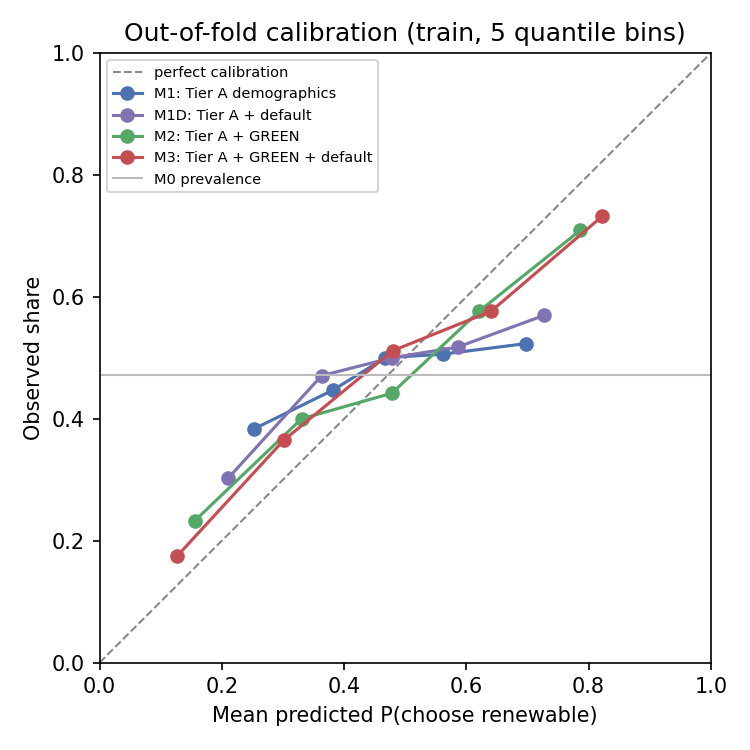

# EXPLORATORY: do measured values beat demographics for predicting the green choice?

> **Exploratory follow-up, not pre-registered.** It was added after the frozen holdout had been inspected. It uses the **training split only** (the test split is not read), and none of the original hypotheses, results or persona estimates were changed. The outcome is a **hypothetical** scenario choice ($39/month renewable vs $32), not a purchase.

Data: `default_eric`, n = 428 train participants (202 chose renewable). The same participants and the same stratified 5-fold split are used for every model. One-hot encoding and standardisation are fitted inside each training fold. The model is L2 logistic regression with C = 1.0, fixed in advance.

**Feature timing:** Tier A demographics and GREEN are *pre-decision* facts about the person. The default is *choice architecture*: it is known only once the choice is presented, and it is set by whoever designs the offer, not by the person.

## Out-of-fold performance

| Model | Features | Brier | Log loss | AUC | Calibration-in-the-large | Calibration slope | ECE (5 bins) |
|---|---|---|---|---|---|---|---|
| M0 | Prevalence baseline | 0.2492 | 0.6916 | undefined | +0.000 | – | 0.000 |
| M1 | Tier A demographics | 0.2603 | 0.7186 | 0.551 | -0.000 | 0.25 | 0.092 |
| M1D | Tier A + default | 0.2496 | 0.6965 | 0.604 | -0.001 | 0.45 | 0.090 |
| M2 | Tier A + GREEN | 0.2270 | 0.6512 | 0.688 | -0.002 | 0.63 | 0.061 |
| M3 | Tier A + GREEN + default | 0.2144 | 0.6199 | 0.725 | -0.002 | 0.70 | 0.060 |

AUC is undefined for M0, which predicts a near-constant prevalence. A calibration slope below 1 means the predictions are too extreme; above 1, too timid.

## Paired differences (A − B; participant bootstrap, 2000 resamples; negative Brier or log loss = A better)

| Contrast | ΔBrier (95% CI) | ΔLog loss (95% CI) | ΔAUC (95% CI) | Verdict |
|---|---|---|---|---|
| M1 vs M0 | +0.0111 (-0.0043, +0.0259) | +0.0270 (-0.0074, +0.0600) | – | no detectable difference |
| M2 vs M1 | -0.0334 (-0.0480, -0.0182) | -0.0675 (-0.1026, -0.0298) | +0.136 (+0.091, +0.183) | practically meaningful improvement |
| M1D vs M1 | -0.0107 (-0.0210, +0.0004) | -0.0222 (-0.0452, +0.0021) | +0.053 (+0.015, +0.089) | no detectable difference |
| M3 vs M1D | -0.0352 (-0.0507, -0.0192) | -0.0766 (-0.1137, -0.0365) | +0.121 (+0.079, +0.164) | practically meaningful improvement |
| M3 vs M2 | -0.0126 (-0.0240, -0.0014) | -0.0313 (-0.0584, -0.0061) | +0.038 (+0.010, +0.067) | borderline: meaningful in main run, below threshold in median of other fold seeds |

## Reading

- **Demographics alone add no predictive value.** M1's Brier is 0.260 vs 0.249 for prevalence, worse under every fold seed. Its calibration slope of 0.25 shows over-fitted, too-extreme predictions: about 40 one-hot columns on 428 people.
- **One measured value carries the signal.** Adding GREEN to demographics improves Brier by 0.033 and AUC by +0.14. Holding the default constant (M3 vs M1D), the gain is 0.035. Both clear the pre-set threshold under all six fold assignments.
- **The randomised default adds a smaller, borderline amount** once GREEN is in the model (ΔBrier -0.013).
- **Even the best model (M3) is modest:** AUC 0.73, Brier 0.214 vs 0.249. All models are over-extreme (calibration slope < 1). Recalibration or stronger regularisation would help, but was not tuned here.
- **Caveats:** a single 428-person training split; a hypothetical outcome; C fixed rather than tuned. Unregularised or GREEN-only models were not run.

*Practically meaningful* was fixed before running: a Brier improvement of at least 0.01 with a CI excluding 0.

## Robustness to fold assignment (ΔBrier, 5 other fold seeds)

| contrast   |     min |   median |     max |
|:-----------|--------:|---------:|--------:|
| M1 vs M0   |  0.0086 |   0.0147 |  0.0267 |
| M1D vs M1  | -0.0102 |  -0.0088 | -0.0076 |
| M2 vs M1   | -0.0378 |  -0.0354 | -0.0279 |
| M3 vs M1D  | -0.038  |  -0.0369 | -0.0295 |
| M3 vs M2   | -0.0117 |  -0.0097 | -0.009  |

