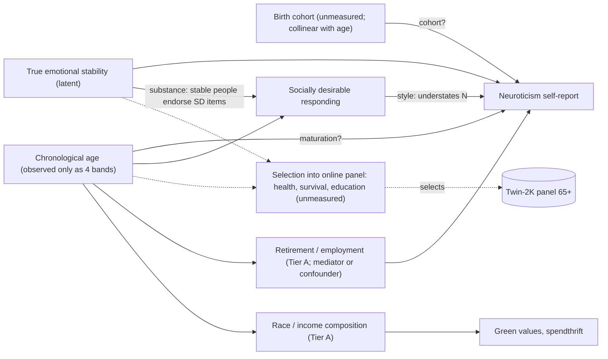
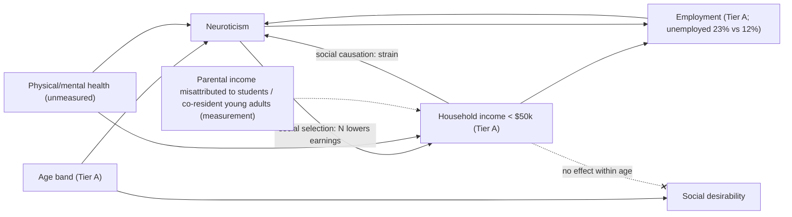

# Why do the personas fit? Mechanism checks (Workstream A)

**Scope and rules.** Every *new* number here comes from the **training split only** (n = 1,442), with corrected social-desirability (SD) and CRT scores (`load_people(corrected=True)`). Held-out numbers are **quoted** from frozen files and were not recomputed. Script: `mechanisms.py` (seed 20261114). Outputs: `results.csv` (438 rows) and `results.json`.

**Units.** All effects are in **train-population SD units (z)**.
- *Frozen d* = member mean minus population mean. Members are included in the population, which is the convention of the persona reports.
- *m0* = members vs non-members, so it is somewhat larger than frozen d.
- CIs are 95%: HC3-robust OLS for models, and 2,000-draw bootstrap for subgroup differences.

**Adjustment ladder.** Covariates are added in steps.
- *m1*: adds the non-defining Tier A variables (region, sex, education, race, marital, income, household size). Citizenship is dropped because only 4 people in the panel are non-citizens.
- *m2*: adds employment. Employment may be a mediator (retirement, unemployment), so m2 can over-adjust.
- *m3*: m1 plus SD. SD can be read as response style or as real personality, so m3 can also over-adjust (see ALTERNATIVE_EXPLANATIONS.md).

Companion files: `ALTERNATIVE_EXPLANATIONS.md` (competing explanations, external evidence, what would falsify each) and `CAUSAL_LIMITATIONS.md` (what this dataset cannot identify, and defects found in the frozen submission).

---

## P1 — adults 65+ (train n = 194)

### Three strongest patterns (held-out evidence, quoted)
| # | Pattern | Train d → held-out d | Held-out MAE gain | Source |
|---|---|---|---|---|
| 1 | Lower neuroticism | −0.43 → −0.58 | +13.2% (abs. CI 0.041–0.190) | `results/holdout_personas.csv`; `reports/personas/P1_adults_65plus_evidence.md` |
| 2 | Higher social desirability (corrected) | +0.39 → +0.47 | +9.3% (abs. CI 0.068–0.50) | `reports/final_audit/corrected_scores/personas_sd_crt.csv` |
| 3 | Slightly greener and more tightwad (weak) | green +0.15 → +0.14; spendthrift −0.13 → −0.24 | green +3.2% (abs. CI 0.006–0.046); spendthrift +1.9% (CI includes 0) | `results/holdout_personas.csv` |

### Does each pattern survive adjustment? (train)
| Outcome | m0 | m1 (+Tier A) | m2 (+employment) | m3 (+SD) | m1 + employment + SD |
|---|---|---|---|---|---|
| Neuroticism | −0.50 (−0.64, −0.36) | **−0.41 (−0.57, −0.26)** | −0.32 (−0.48, −0.15) | −0.25 (−0.39, −0.11) | −0.18 (−0.33, −0.02) |
| Social desirability | +0.45 (+0.30, +0.59) | **+0.39 (+0.23, +0.55)** | +0.34 (+0.17, +0.52) | — | — |
| Green values | +0.17 (+0.02, +0.32) | +0.11 (−0.05, +0.27) | +0.13 (−0.04, +0.31) | +0.07 (−0.09, +0.23) | — |
| Spendthrift | −0.15 (−0.29, −0.01) | −0.08 (−0.23, +0.07) | −0.05 (−0.22, +0.12) | −0.07 (−0.22, +0.09) | — |

- Patterns 1 and 2 survive every adjustment.
- Pattern 3 disappears once Tier A composition is held fixed. P1 is 85% White vs 65% among under-65s, and 48% of P1 has income below $50k.
- The weak green and spendthrift tilts are therefore best read as **composition** of the 65+ panel, not as an age signal.

### Subgroup reversals (65+ vs under-65, within subgroup)
- **Neuroticism.** The gap is negative in every subgroup:
  - men −0.54, women −0.48;
  - income <$50k −0.65, ≥$50k −0.45;
  - BA+ −0.43, no BA −0.56;
  - White −0.50 (n = 164), non-White −0.65 (n = 30).
  - All CIs exclude 0, and no interaction is significant (all p > 0.18). Black, Hispanic and Asian 65+ each have n < 20, so they were not estimated.
- **SD.** Positive in every subgroup (+0.36 to +0.52). For non-White members (n = 30) the CI just includes 0.
- **Green.** The weak tilt sits in women (+0.27) and in the <$50k group (+0.33). It is about 0 in men and in the ≥$50k group (interactions not significant).
- **No reversals.**

### Age shape (4 bands only)
- **Neuroticism** falls steadily: +0.43, +0.11, −0.20, −0.43 z (18–29 → 65+). The step is −0.30 per band, and the test of departure from linearity gives p = 0.70.
- **SD** is flat up to age 49 (−0.15, −0.19), then rises (+0.13, +0.39). Departure from linearity p = 0.003, so the SD age gradient is a **50+ phenomenon**.
- The bands cannot show whether neuroticism keeps falling after about 75, or rises again in very old age. 65+ is open-ended, so the panel's 65+ is probably mostly young-old.

### Response-style check (item level, train)
- **Neuroticism, by item keying.** The 65+ gap is −0.55 on the 5 forward-keyed BFI items and −0.32 on the 3 reverse-keyed items (CIs exclude 0).
  - All 8 single items show a negative gap (−0.17 to −0.51).
  - Acquiescence would push the two halves in **opposite** directions. Because both halves move the same way, most of the gap is content.
  - Their average, which is balanced for acquiescence, is about −0.44. This is ≤ 0.1 SD smaller than the 5:3 weighted scale, so acquiescence can account for at most about a tenth of the gap.
- **SD, by item keying.** The 65+ gap is +0.24 on the TRUE-keyed items and +0.50 on the FALSE-keyed items. Both are positive, so higher SD is not simply nay-saying.

### Causal diagram (P1)

Reading the diagram: solid arrows are candidate causal paths. Dotted arrows are selection, and conditioning on the panel opens AGE ↔ PERS paths. Cohort and maturation both feed N and cannot be separated in one cross-section.

### Predictive vs causal
- **Predictive (supported, held out):** knowing someone is 65+ in this panel shifts the expected neuroticism by −0.4 to −0.6 SD and SD by +0.4 to +0.5 SD.
- **Causal (not identified):**
  - Whether *ageing* lowers neuroticism cannot be separated from cohort or survivorship.
  - Whether part of the gap is self-presentation cannot be settled with one self-report scale. A third of the gap is shared with SD, but the SD scale may itself measure real adjustment.

---

## P2 — 18–49 and household income < $50k (train n = 291)

### Three strongest patterns (held-out evidence, quoted)
| # | Pattern | Train d → held-out d | Held-out MAE gain | Source |
|---|---|---|---|---|
| 1 | Higher neuroticism | +0.47 → +0.55 | +11.2% (abs. CI 0.044–0.184) | `results/holdout_personas.csv` |
| 2 | Lower social desirability (corrected) | −0.21 → −0.25 | +2.0% (CI includes 0) | `reports/final_audit/corrected_scores/personas_sd_crt.csv` |
| 3 | Slightly less green (weak) | −0.15 → −0.15 | −0.1% | `results/holdout_personas.csv` |

### Adjustment (train)
| Outcome | m0 | m1 | m2 (+employment) | m3 (+SD) | Within 18–49: low vs higher income, adjusted for age band and Tier A |
|---|---|---|---|---|---|
| Neuroticism | +0.59 (+0.47, +0.71) | **+0.42 (+0.29, +0.56)** | +0.34 (+0.21, +0.47) | +0.35 (+0.23, +0.46) | **+0.24 (+0.09, +0.39)** |
| Social desirability | −0.27 (−0.39, −0.14) | −0.18 (−0.32, −0.05) | −0.15 (−0.28, −0.01) | — | **−0.01 (−0.16, +0.14)** |
| Green values | −0.19 (−0.31, −0.06) | −0.08 (−0.22, +0.05) | −0.09 (−0.22, +0.05) | −0.07 (−0.20, +0.07) | −0.05 (−0.21, +0.10) |

### Composition: is P2's neuroticism mostly the young?
Decomposition of P2's neuroticism d (+0.47; bootstrap CI 0.36–0.58):

| Component | Estimate | Bootstrap 95% CI |
|---|---|---|
| Expected from P2's age-band mix alone (37% are 18–29) | +0.23 | 0.16–0.30 |
| Remainder: income within age | +0.24 | 0.15–0.33 |

- About **half is age, half is income**.
- P2 members aged 18–29 sit at +0.66 (n = 108); those aged 30–49 at +0.36 (n = 183).
- Excluding students barely changes it (+0.46).

**P2's lower SD is entirely age.** Within ages 18–49, low income has no SD effect (−0.01). Of P2's −0.21 SD, −0.17 is predicted by the age mix alone. The income criterion adds nothing to this trait.

**Green: also no income effect.** The weak green deficit vanishes after Tier A adjustment, and low income within age adds nothing (−0.05).

### Subgroup reversals and age × income
- **Neuroticism** is positive in every subgroup: men +0.55, women +0.65, BA+ +0.71, no BA +0.45, White +0.64, Black +0.63 (n = 42), Hispanic +0.54 (n = 34), Asian +0.74 (n = 22). There are no reversals.
  - P2 × BA is borderline (+0.26, p = 0.051). The gap is larger, not smaller, among graduates, so it is not explained by education.
- **The income–neuroticism gradient shrinks with age:**

  | Age band | Low-income minus other (z) | 95% CI |
  |---|---|---|
  | 18–29 | +0.37 | 0.16–0.56 |
  | 30–49 | +0.39 | 0.20–0.56 |
  | 50–64 | +0.23 | 0.04–0.41 |
  | 65+ | +0.15 | −0.11 to 0.42 |

  The frozen memo says the link holds "within every age band". For 65+ the direction holds but the CI includes 0.
- **SD and green:** the direction is the same in every subgroup.

### Response style
- The P2 neuroticism gap appears on both forward-keyed (+0.60) and reverse-keyed (+0.47) items. All 8 items are positive (+0.32 to +0.62).
- P2 says "True" more often on the SD scale (+0.22), which fits acquiescence. Its SD deficit appears in both the TRUE-keyed (−0.16) and FALSE-keyed (−0.28) halves.

### Causal diagram (P2)


### Predictive vs causal
- **Predictive:** the age-band and income criteria each carry about +0.24 SD of neuroticism signal, and this replicates out of sample.
- **Causal:** the direction (strain → distress vs distress → lower earnings vs health → both) is not identified. Income is household-level and measured at the same time as neuroticism.

---

## P3 — 18–29 never married (train n = 197)

### Three strongest patterns (held-out evidence, quoted)
| # | Pattern | Train d → held-out d | Held-out MAE gain | Source |
|---|---|---|---|---|
| 1 | Higher neuroticism | +0.43 → +0.55 | +14.4% (abs. CI 0.061–0.203) | `results/holdout_personas.csv` |
| 2 | Lower green values | −0.27 → −0.40 | +0.7% (CI includes 0) | `results/holdout_personas.csv` |
| 3 | Lower SD (corrected, weak) | −0.16 → −0.30 | +1.75% (CI includes 0) | `reports/final_audit/corrected_scores/personas_sd_crt.csv` |

### Adjustment (train)
| Outcome | m0 | m1 | m3 (+SD) | **Within 18–29: never married vs other, raw** | Within 18–29, adjusted for sex, income, education, race, region, household size | + employment |
|---|---|---|---|---|---|---|
| Neuroticism | +0.50 (+0.36, +0.64) | +0.47 (+0.32, +0.62) | +0.36 (+0.23, +0.50) | **−0.01 (−0.26, +0.25)** | +0.04 (−0.24, +0.32) | −0.08 (−0.38, +0.23) |
| Green values | −0.32 (−0.47, −0.16) | −0.23 (−0.40, −0.07) | −0.21 (−0.37, −0.04) | **−0.58 (−0.82, −0.34)** | −0.39 (−0.69, −0.10) | −0.31 (−0.63, +0.01) |
| Social desirability | −0.19 (−0.33, −0.05) | −0.25 (−0.40, −0.09) | — | **−0.03 (−0.30, +0.23)** | −0.19 (−0.51, +0.13) | −0.09 (−0.45, +0.27) |

- **The marital criterion adds nothing for neuroticism or SD.** Within 18–29, never-married and partnered people do not differ (−0.01 and −0.03). P3's two "temperament" traits are simply the 18–29 age band.
- **Green values are the only trait where "never married" carries information.** That information rests on a small comparison group: 75 partnered or married 18–29s, of whom 60% hold a BA vs 33% in P3. This group is unusually green: married +0.36 (n = 26), cohabiting +0.26 (n = 47).
- **Party (Tier B, labelled sensitivity) does not explain the green gap.** Adding party to the within-age model gives −0.46 (−0.75, −0.17). P3 is 23% Republican vs 27% among other 18–29s.

### Composition: is the green gap concentrated in men?
The answer depends on the reference group.

| Comparison | Men | Women | Interaction |
|---|---|---|---|
| Frozen memo: P3 vs **whole population** | d −0.40 (−0.59, −0.20) | d −0.12 (−0.32, +0.09) | not tested |
| P3 vs non-members of the same sex (train) | −0.37 (−0.59, −0.16) | −0.23 (−0.45, −0.02) | P3 × male −0.14 (−0.45, +0.16) |
| **Within 18–29: never married vs partnered, same sex** | −0.41 (−0.77, −0.06), n = 111 vs 27 | **−0.59 (−0.91, −0.28)**, n = 86 vs 48 | +0.18 (−0.31, +0.66) |

- Young men in general are less green: 18–29 men −0.31 z vs 18–29 women +0.09.
- Measured against the whole population, P3 men therefore look extreme and P3 women look ordinary. But the **marital** contrast is present in both sexes and, if anything, larger in women.
- **Sex composition explains little of it.** P3 is 56% male vs 36% among other 18–29s. Re-weighting P3 to the other group's sex mix moves the within-age gap only from −0.58 to −0.53. Sex-standardised, it is −0.50.
- **Education and student status explain more:** the gap moves −0.58 → −0.39 (adjusted) → −0.31 (with employment).

### Causal diagram (P3)
```mermaid
flowchart LR
  AGE["Age 18–29 (Tier A)"] --> N[Neuroticism]
  AGE --> SDr[Social desirability]
  MAR["Never married (Tier A)"] -.no association within age.-x N
  SEX["Sex (Tier A)"] --> G[Green values]
  AGE --> G
  EDU["Education / student status (Tier A)"] --> G
  EDU --> MAR
  MAR -->|partnering → concern? (speculative)| G
  G -->|values → partner choice / earlier partnering? (reverse)| MAR
  ID["Identity / ideology beyond party (unmeasured)"] --> G
  ID --> MAR
  SELP["Who among 18–29 partners early AND joins an online panel (selection)"] -.-> MAR
```

### Predictive vs causal
- **Predictive:** membership predicts +0.5 SD neuroticism (age alone does the same) and −0.3 SD green values. The green shift replicated (held-out −0.40) but gives no individual-level gain (+0.7%).
- **Causal:** nothing about partnering → green concern is identified.
  - Partnered 18–29s are a small, educated, selected group.
  - The direction could run the other way (values → partner choice).
  - External panel evidence on family formation finds no reliable boost to environmental concern (see ALTERNATIVE_EXPLANATIONS.md).

---

## Cross-persona summary
| Persona | Pattern | Survives Tier A adjustment? | What the data actually discriminates |
|---|---|---|---|
| P1 | Lower neuroticism | Yes (−0.41) | Not acquiescence (both keyings); not education, race or sex composition; no subgroup reversal. Cannot separate maturation, cohort or selection |
| P1 | Higher SD | Yes (+0.39) | Not nay-saying (both keyings); 50+ step, not linear |
| P1 | Weak green/tightwad tilt | **No** | Composition (race, income, sex) |
| P2 | Higher neuroticism | Yes (+0.42) | About half age, half income within age; income gradient fades after 50 |
| P2 | Lower SD | Yes (−0.18), but **all of it is age** | The income criterion adds 0 |
| P2 | Weak green deficit | **No** | Composition |
| P3 | Higher neuroticism | Yes, but **all of it is age** | "Never married" adds 0 within 18–29 |
| P3 | Lower green | Partly (−0.23 vs population; −0.39 within age) | Not sex composition, not party; partly education/student status; rests on n = 75 comparators |
| P3 | Lower SD | Yes vs population; **0 within age** | Age |
